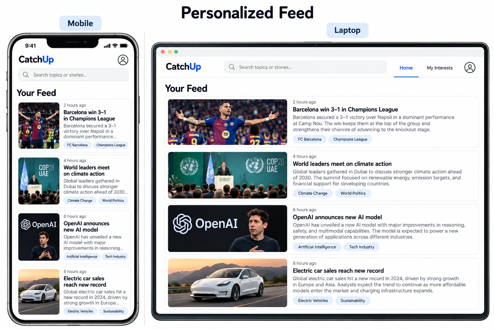
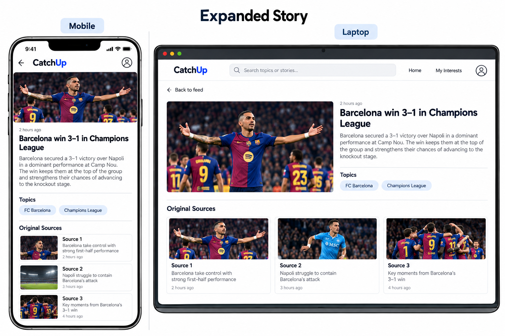
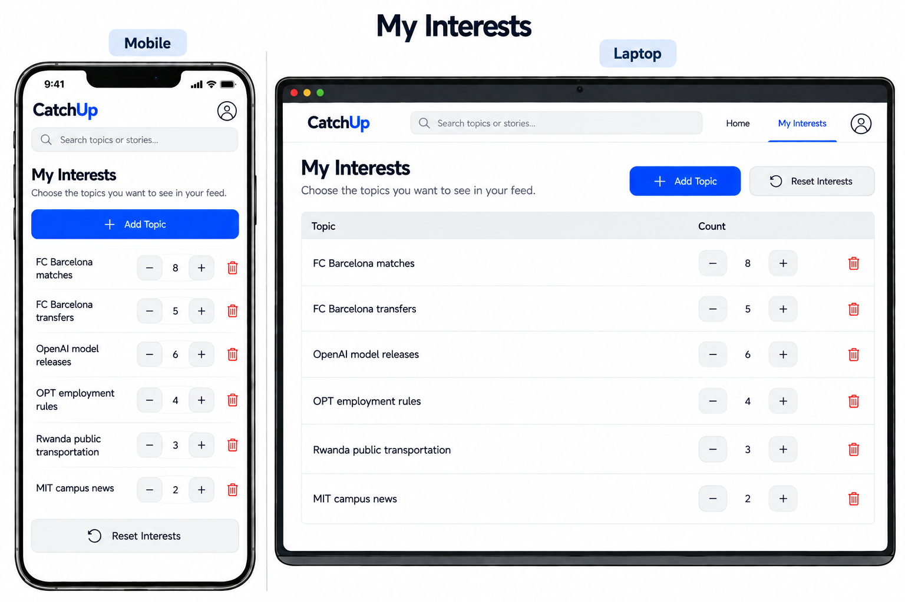
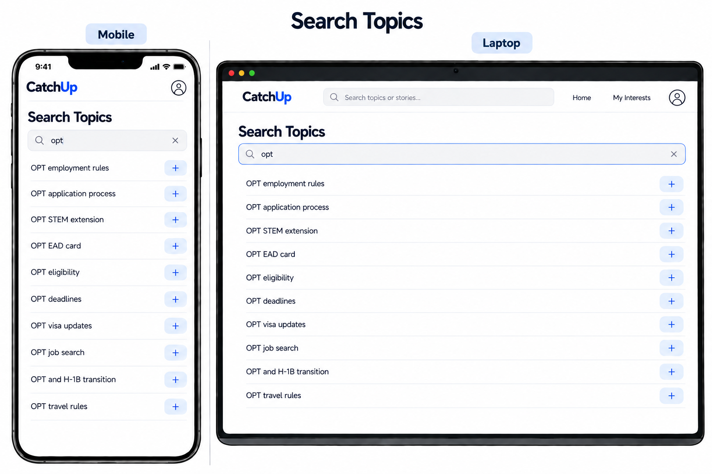

# Personal Project Design

## Problem framing

### Domain

News is one of the main ways people stay informed about what is happening around them and the things they care about. People might follow broad areas like politics or sports, but their actual interests are often much more specific, such as FC Barcelona, OpenAI model releases, or Rwanda's public transportation. They get this news from many places, including news websites, social media, newsletters, TV, and news aggregators. Different journalists and news organizations also often report on the same event, each publishing their own version of the story. Readers want to keep up with the topics that matter to them, while journalists and news organizations want their reporting to reach people who are interested in it.

### Bad Situations

Alex is a sophomore international student at MIT who is a big FC Barcelona fan and also likes to keep up with changes to U.S. employment rules that could affect him after graduation. Every morning, he opens Instagram to catch up, but before finding what he cares about, he scrolls past stories about Real Madrid, the Spanish national team, general U.S. politics, and other news that is somewhat related but not actually important to him. On busy school days, he may close the app before ever reaching an important update about a new OPT rule or a Barcelona match. Alex still wants to know what is happening outside of his classes, but he does not want catching up on a few specific interests to turn into another hour of doomscrolling.

### Corroboration

Alex’s situation is not unusual, especially for younger people. Across 48 markets, 44% of 18–24-year-olds say social media and video networks are their main source of news [1]. Reuters also found that younger people consume news less intentionally on these platforms, often coming across it while they are there for other reasons [2]. At the same time, there is some demand for making news easier to catch up on: 27% were interested in AI-generated summaries and 21% in better story recommendations [1]. However, people are still cautious about news personalization and worry that algorithms could cause them to miss important stories [3].

Sources:

- [1] [Newman, Nic, et al. “Overview and Key Findings of the 2025 Digital News Report.” Reuters Institute for the Study of Journalism, 2025.] (https://reutersinstitute.politics.ox.ac.uk/digital-news-report/2025/dnr-executive-summary)

- [2] [Robertson, Craig T., et al. “Understanding Young News Audiences at a Time of Rapid Change.” Reuters Institute for the Study of Journalism, 2026.] (https://reutersinstitute.politics.ox.ac.uk/understanding-young-news-audiences-time-rapid-change)

- [3] [Ross Arguedas, Amy. “How Audiences Think About News Personalisation in the AI Era.” Reuters Institute for the Study of Journalism, 2025.] (https://reutersinstitute.politics.ox.ac.uk/digital-news-report/2025/how-audiences-think-about-news-personalisation-ai-era)

### Workarounds and Comparables

People already try to solve this in a few ways. They follow specific accounts on social media, subscribe to newsletters, use apps like Google News, or manually check the websites they trust. These options help, but each has tradeoffs. Social media learns from what people interact with, but news is mixed with entertainment and other content. News aggregators personalize feeds, but users still have to go through many individual articles, including several sources reporting the same event. Newsletters can be more focused, but following several interests often means subscribing to several newsletters. These approaches reduce some of the searching, but keeping up with a few very specific interests can still require more scrolling, reading, and switching between sources than the reader actually wants.

### Solution Sketch

The idea is to build a news app that gives each user one feed based on the specific topics they care about. Articles from different sources that report the same story will be grouped together, and the user will see a short AI-generated summary instead of several versions of the same news. Each story will also have specific topics attached to it, such as `FC Barcelona matches` or `OPT employment rules`. As users read stories, the app learns which topics they follow most and uses that history to shape their feed while avoiding stories they have already read. Users can also directly add, remove, reset, or adjust their interests instead of leaving the recommendation system completely out of their control. If they want more than the summary, they can expand the story and choose one of the original sources to read.

### Stakeholders

- News readers: People who want to stay informed about specific topics they care about without spending too much of their time searching, scrolling, or reading the same story from different sources.

- News organizations: Organizations such as CNN and BBC that produce and publish the original reporting. Their articles provide the news available through the app, while readers can still visit the original source whenever they want to read the full story.

---

## Application Pitch

### Name

CatchUp

### Motivation

CatchUp helps people stay informed about the specific things they care about without spending their limited time searching and scrolling through unrelated or repeated news.

### Key Features

- Personalized Feed: CatchUp builds each reader a feed around the specific topics they care about and what they have previously read. Instead of searching across different platforms, readers can open one feed and quickly see relevant stories they have not already read.

- One Story, Multiple Sources: When different news organizations report the same event, CatchUp groups those articles into one story and provides a short AI-generated summary. This reduces repeated news while still letting readers expand the story and choose which original source they want to read.

- Controllable Interests: Readers can see the topics CatchUp has learned from their reading, add topics they care about, and remove, reset, or adjust existing ones. This lets the feed adapt automatically while still giving readers control when their interests change.

---

## Concept Design

### Concept 1: StoryGrouping

concept: StoryGrouping [Article, Story, Topic]

purpose: groups articles reporting the same event into one story to prevent users from seeing repeated stories of the same news

principle: after adding an article, it belongs to a matching existing story or a new story is created for it

state

- A set of Stories with
  - a set of Articles
  - a summary String
  - a set of Topics

actions

- addArticle (article: Article)
  - then finds an existing story sufficiently similar to the article, and adds the article to that story. Otherwise creates a new story containing the article and generates its summary and topics.

- topics (story: Story): (topics: set of Topics)
  - then returns the topics associated with the story

- getStories (): (stories: set of Stories)
  - then returns the available stories

### Concept 2: InterestTracking

concept: InterestTracking [User, Topic]

purpose: tracks how strongly a user is interested in different topics and allows interests to adapt from reading while remaining under user control

principle: after recording interest in a topic for a user, that topic's count reflects the user's interest in it

state

- A set of Users with
  - interests: a set of Topics with count Number

actions

- increase (user: User, topic: Topic)
  - then increases the topic's count for the user by 1

- add (user: User, topic: Topic, count: Number)
  - where the user does not already have the topic
  - then adds the topic with the given count

- setCount (user: User, topic: Topic, count: Number)
  - where the user has the topic - then changes its count

- remove (user: User, topic: Topic)
  - where the user has the topic
  - then removes the topic

- reset (user: User)
  - then removes all topics and their counts for the user

- getInterests (user: User): (interests: Map)
  - then returns the user's topics and their counts

### Concept 3: ReadingHistory

concept: ReadingHistory [User, Story]

purpose: remembers which stories a user has already read and prevents repeatedly showing the same stories to a user

principle: after recording that a user read a story, that story is part of the user's reading history

state

- A set of Users with
  - readStories: a set of Stories

actions

- record (user: User, story: Story)
  - where the story is not already in the user's readStories
  - then adds the story to the user's readStories

- hasRead (user: User, story: Story): (read: Boolean)
  - then returns whether the story is in the user's readStories

- getReadStories (user: User): (stories: set of Stories)
  - then returns the user's read stories

### Concept 4: FeedCurating

concept: FeedCurating [User, Story]

purpose: provides each user with stories that are most relevant to them and prevents users from spending time searching through less relevant stories

principle: when a feed is generated for a user, relevant unread stories are ranked higher based on the user's interests

state

- A set of Users with
  - a feed ordered set of Stories

actions

- generate (user: User, stories: set of Stories, interests: Map, readStories: set of Stories): (feed: ordered set of Stories)
  - then ranks unread stories based on how well they match the user's interests, saves the resulting feed, and returns it

### Essential Reactions

The most important reaction is when a user reads a story.

- reaction recordReading
  - when Requesting.readStory (user, story)
  - then ReadingHistory.record (user, story)

- reaction updateInterests
  - when ReadingHistory.record (user, story) && StoryGrouping.topics (story): (topics)
  - then InterestTracking.increase (user, topic) for each topic in topics

- reaction requestFeedData
  - when Requesting.viewFeed (user)
  - then InterestTracking.getInterests (user) && ReadingHistory.getReadStories (user) && StoryGrouping.getStories ()

- reaction generateFeed
  - when Requesting.viewFeed (user) && InterestTracking.getInterests (user): (interests) && ReadingHistory.getReadStories (user): (readStories) && StoryGrouping.getStories (): (stories)
  - then FeedCurating.generate (user, stories, interests, readStories)

### Concept Roles

- `StoryGrouping` organizes articles from different news organizations into stories about the same event and provides the summary and topics for each story.

- `InterestTracking` keeps track of the topics each user is interested in and how strong those interests are.

- `ReadingHistory` remembers which stories a user has already read.

- `FeedCurating` brings this information together to rank unread stories and create the personalized feed.

In CatchUp, `Article` represents an article published by a news organization, `Story` represents one event that may contain articles from multiple sources, `Topic` represents a specific reusable subject such as `FC Barcelona matches`, and `User` represents an authenticated CatchUp user.

---

## UI Sketches

The following sketches show the main interactions in CatchUp on both mobile and laptop layouts. I used AI to better visualize these layouts.

### Personalized Feed

### Expanded Story

### My Interests

### Add Interest

---

## User Journey

## User Journey

Alex is an international student at MIT who wants to quickly catch up on FC Barcelona and changes to OPT employment rules before starting his day. Instead of opening several news and social media apps, he opens CatchUp.

On the `Personalized Feed`, Alex sees unread stories ranked based on his interests. He notices a story about an FC Barcelona match. Several news organizations reported on the match, but CatchUp groups them into one story and shows Alex a short summary. He opens the story and sees the `Expanded Story` page, where he can read the full summary and choose one of the original sources if he wants more details.

Afterward, Alex opens `My Interests` and notices that FC Barcelona matches has a higher count because he frequently reads those stories. He can increase or decrease the count himself, remove an interest, or reset everything. He also wants more news about OPT employment rules, so he opens `Add Interest`, searches for it, and adds it to his interests.

The next time Alex opens CatchUp, stories related to the topics he cares about are ranked higher, while stories he has already read are left out. He is able to catch up on the news that matters to him without spending as much time searching and scrolling through unrelated or repeated stories.
